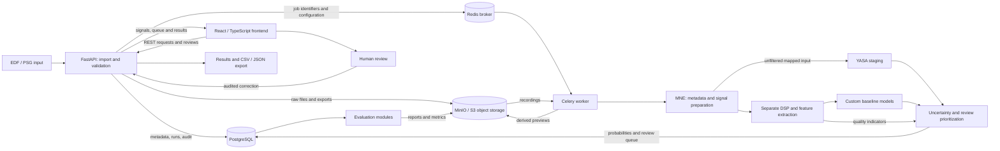

# HypnoReview

**Human-in-the-loop EEG sleep staging, uncertainty-aware review, and reproducible evaluation.**

**Status: Phase 4 — Review engine**

Domains: biomedical signal processing · neuroinformatics · machine learning · full-stack engineering · reproducible research.

HypnoReview is intended for research and education. It is not a clinically validated diagnostic medical device, and its proposed outputs are not medical diagnoses.

## Project Overview

HypnoReview is a planned platform for analyzing polysomnography (PSG), proposing sleep-stage labels, and directing human attention toward uncertain epochs. Rather than presenting an automated hypnogram as a final answer, it will connect predictions to signal context, uncertainty, signal quality, and an auditable review workflow.

An overnight recording can contain roughly a thousand 30-second epochs. Automated scoring can reduce repetitive work, but errors, artifacts, and ambiguous transitions still require expert verification. The research question is whether transparent prioritization can find more errors within a fixed review budget than random review or confidence alone.

This repository contains documentation, repository configuration, and an operational metadata/file-integrity audit with offline tests. The Phase 2 CLI now loads EDF signals, aligns source annotations, creates 30-second epochs, and computes descriptive QC. Phase 3 adds YASA inference, a transparent classifier, versioned probability outputs, and small-sample subject-wise development metrics. Phase 4 adds explainable review queues and equal-budget development comparisons. APIs, interactive interfaces, and the locked benchmark remain planned. The intended end-to-end system also includes data provenance, annotation management, model versioning, and reproducible experiments, extending beyond a standalone classification notebook.

## Problem Statement

Long overnight recordings make comprehensive manual verification expensive. Sleep stages change gradually, and transitions such as WAKE versus N1 may remain ambiguous even with neighboring context. Motion, electrode problems, and other artifacts can obscure the signal. Different electrode montages and participant populations can also change model behavior, so high confidence cannot guarantee correctness.

HypnoReview intends to combine stage probabilities, signal quality indicators, transition context, and model disagreement into an explainable review queue. A reviewer will inspect synchronized signals and neighboring epochs before accepting, correcting, or marking a proposal unscorable. The usefulness of this ordering must be measured rather than assumed.

## Project Goals

- Reproduce sleep staging with explicit data, model, and preprocessing provenance.
- Support human review through synchronized hypnograms, EEG windows, and signal context.
- Expose uncertainty and the calculated reasons behind review priority.
- Preserve original annotations separately from predictions and human revisions.
- Evaluate classification and review efficiency without participant leakage.
- Keep computation, API, persistence, and visualization modular and testable.
- Enable future dataset adapters, model comparisons, and open-source collaboration once licensing is finalized.

## Planned Features

**The full platform remains planned. The audit, signal-import foundation, and baseline staging are implemented; the items below describe the eventual scope.**

| Area | Planned capabilities |
|---|---|
| Signal Processing | EDF/EDF+ import; EEG/EOG and optional EMG validation; explicit filtering for visualization and custom models; 30-second segmentation; signal quality indicators; spectral features. |
| Machine Learning | YASA staging; transparent custom baseline classifiers; stage probabilities; uncertainty scoring; model comparison and calibration. |
| Review System | Explainable prioritization; hypnograms; EEG timeline inspection; manual annotation correction; revision history and audit trail. |
| Engineering | FastAPI API; React dashboard; PostgreSQL; Redis/Celery jobs; S3-compatible storage; Docker deployment; reproducible experiments and exports. |

The YASA input branch will follow its version-specific preprocessing contract without additional filtering or z-score normalization. Explicit DSP for visualization and custom classifiers will use a separate, recorded configuration. Deep learning, active learning, multi-scorer workflows, and domain-shift research are later extensions.

## System Architecture

**Planned architecture — no services are deployed or implemented.**



The intended workflow is **EDF/PSG input → validation → signal processing → sleep staging → uncertainty analysis → review queue → human review → results and export**. The API will accept requests and maintain transactional metadata; workers will perform long calculations outside HTTP requests. PostgreSQL will be authoritative for analysis status, while Redis will transport jobs. Binary recordings belong in file/object storage, not the database or broker. The frontend will request bounded signal windows and paginated results rather than entire raw nights.

The specification permits a smaller initial CLI prototype with local storage and SQLite before introducing the full service architecture. This is a future implementation choice. Predictions will belong to versioned analysis runs, and review changes will use append-only history with optimistic locking.

## Technology Stack

This table describes the target platform. Python, MNE, NumPy, SciPy, uv, and scientific test tooling are now configured for the local importer; service, UI, and model technologies remain planned.

| Category | Technology | Intended purpose |
|---|---|---|
| Primary backend language | Python 3.11+ | Typed domain logic and scientific computation. |
| Frontend | React, TypeScript, Vite | Interactive research dashboard. |
| API | FastAPI, Pydantic | Validated REST contracts and OpenAPI. |
| EEG processing | MNE-Python | EDF metadata, channels, and annotation alignment. |
| DSP | NumPy, SciPy | Spectral and statistical features. |
| Sleep staging | YASA, targeting 0.8.x | Pretrained reference staging through a version-specific adapter. |
| Custom ML | scikit-learn; optionally LightGBM | Transparent baseline comparisons and calibration. |
| Database | PostgreSQL | Provenance, runs, predictions, and revision metadata. |
| ORM | SQLAlchemy 2 | Transactional persistence. |
| Database migrations | Alembic | Versioned schema changes. |
| Task queue | Celery | Separate analytical workers. |
| Message broker | Redis | Job transport; not the sole analysis-status store. |
| Object storage | MinIO / S3-compatible | Raw recordings and derived binary artifacts. |
| Visualization | Plotly.js, Canvas/WebGL where appropriate | Hypnograms, spectra, and bounded waveform rendering. |
| Frontend server-state management | TanStack Query | Query caching and invalidation. |
| Testing | pytest, HTTPX, Playwright | Scientific, API, and UI verification. |
| Code quality | Ruff, mypy | Linting and static typing. |
| Python package management | uv | Future dependency management and verified lockfile. |
| Containers | Docker, Docker Compose | Future reproducible local deployment. |
| CI/CD | GitHub Actions | Current repository checks; application CI in later phases. |

Exact versions and compatibility will be verified when components are introduced. Phase 2 provides a verified `uv.lock`, a Python package, and the local `hypnoreview-import` CLI. Service and ML dependencies remain deferred.

## Repository Structure

### Planned Repository Structure

**This is the planned final architecture, not the current filesystem.** Names illustrate intended responsibilities and may be refined before implementation. Files shown here remain planned except for the working components listed in the current structure below. No fake application scaffolding or Docker configuration is generated; the current uv.lock resolves the real signal package.

```text
hypnoreview/
├── apps/
│   ├── api/
│   │   └── hypnoreview_api/
│   │       ├── main.py
│   │       ├── routers/
│   │       │   ├── recordings.py
│   │       │   ├── analysis.py
│   │       │   └── reviews.py
│   │       ├── schemas/
│   │       ├── services/
│   │       └── database/
│   └── web/
│       ├── src/
│       │   ├── api/
│       │   ├── components/
│       │   │   ├── EEGViewer.tsx
│       │   │   └── Hypnogram.tsx
│       │   ├── pages/
│       │   ├── hooks/
│       │   ├── types/
│       │   └── utils/
│       ├── package.json
│       └── vite.config.ts
├── packages/
│   ├── core/
│   │   ├── annotations.py
│   │   └── types.py
│   ├── signals/
│   │   ├── edf_loader.py
│   │   ├── preprocessing.py
│   │   ├── epochs.py
│   │   └── quality.py
│   ├── models/
│   │   ├── yasa_adapter.py
│   │   ├── baseline.py
│   │   └── inference.py
│   ├── ranking/
│   │   ├── uncertainty.py
│   │   └── prioritization.py
│   └── evaluation/
│       ├── splits.py
│       ├── metrics.py
│       └── benchmarking.py
├── worker/
│   ├── celery_app.py
│   └── tasks.py
├── migrations/
├── experiments/
│   ├── configs/
│   ├── notebooks/
│   └── reports/
├── tests/
│   ├── unit/
│   ├── integration/
│   └── e2e/
├── docs/
│   ├── architecture/
│   ├── api/
│   ├── datasets/
│   └── experiments/
├── infrastructure/
│   ├── docker/
│   └── compose/
├── artifacts/
├── .github/
│   ├── workflows/
│   │   └── repository-checks.yml
│   └── ISSUE_TEMPLATE/
├── .gitignore
├── .editorconfig
├── .env.example
├── Dockerfile
├── docker-compose.yml
├── pyproject.toml
├── uv.lock
├── README.md
└── LICENSE
```

| Directory | Intended responsibility |
|---|---|
| `apps/api`, `apps/web` | HTTP boundary and frontend, respectively. |
| `packages/core` | Shared types, annotation vocabulary, and validation contracts. |
| `packages/signals` | EDF reading, epoch alignment, DSP, and signal quality. |
| `packages/models` | Versioned model adapters and inference contracts. |
| `packages/ranking` | Uncertainty and review ordering. |
| `packages/evaluation` | Participant splits, metrics, and benchmark methodology. |
| `worker` | Background job orchestration. |
| `migrations` | Database evolution. |
| `experiments` | Configurations, exploratory notebooks, and measured reports. |
| `tests` | Unit, integration, and end-to-end verification. |
| `docs` | Architecture, API, dataset, and experiment documentation. |
| `infrastructure` | Deployment configuration introduced in later phases. |
| `artifacts` | Local generated outputs; excluded from Git. |
| `.github` | Repository checks and possible future collaboration templates. |

`LICENSE` is conditional on explicit selection of a software license. `.env.example`, package manifests, and container files will be added only when meaningful configurations exist.

### Current Repository Structure

The current working directory contains the following files, excluding Git internals, Python caches, and virtual-environment contents. The local project specification is preserved and explicitly ignored; it is not part of any commit or upload.

```text
hypnoreview/
├── .github/workflows/repository-checks.yml
├── .editorconfig
├── .gitignore
├── pyproject.toml
├── uv.lock
├── requirements-audit.txt
├── packages/
│   ├── __init__.py
│   ├── core/{__init__.py,annotations.py}
│   ├── signals/{__init__.py,edf_loader.py,epochs.py,quality.py,pipeline.py,cli.py}
│   ├── models/{__init__.py,contracts.py,features.py,baseline.py,yasa_adapter.py,cli.py}
│   ├── evaluation/{__init__.py,classification.py,review.py}
│   └── ranking/{__init__.py,uncertainty.py,context.py,prioritization.py,cli.py}
├── tools/{__init__.py,audit_sleep_edf.py}
├── tests/
│   ├── unit/{test_dataset_audit.py,test_signal_foundation.py,test_models.py,test_review_engine.py}
│   └── integration/{test_edf_import.py,test_yasa_adapter.py,test_model_development_guard.py,test_review_reference_separation.py}
├── docs/datasets/DATASET_CARD.md        # local only, ignored
├── data/audit/                         # source metadata, manifest, samples; ignored
├── derived/imports/                    # local JSON import results; ignored
├── artifacts/models/                   # model parameters, features, probabilities, metrics; ignored
├── artifacts/review/                   # ranked queues, comparison metrics, curve PNGs; ignored
├── .venv/                             # local audit environment; ignored
├── .venv-signals/                      # Python 3.12 signal environment; ignored
├── HypnoReview_Projektova_Specifikace.md # local only, ignored
├── PHASE0_COMPLETION_REPORT.md         # local only, ignored
├── PHASE1_COMPLETION_REPORT.md         # local only, ignored
├── PHASE2_COMPLETION_REPORT.md         # local only, ignored
├── PHASE3_COMPLETION_REPORT.md         # local only, ignored
├── PHASE4_COMPLETION_REPORT.md         # local only, ignored
└── README.md
```

## Data Sources

The primary planned source is [Sleep-EDF Database Expanded v1.0.0](https://physionet.org/content/sleep-edfx/1.0.0/) on PhysioNet. Its EDF PSG recordings and associated hypnograms are candidates for research experiments, not a dataset already imported or supported by this repository. The Phase 1 metadata audit matched all 197 recording/annotation pairs to the official subject tables: 153 SC nights from 78 participants and 44 ST nights from 22 participants. Phase 2 validates original headers and annotation coverage for the five local development nights.

Sleep-EDF uses historical Rechtschaffen & Kales (R&K) annotation conventions. A documented five-class mapping will combine historical stages 3 and 4 into N3, while preserving the original labels. Movement and unscored intervals must remain explicit and be excluded from standard five-class metrics under a predefined eligibility policy. This mapping does not make the source annotations equivalent to modern AASM scoring.

The local audit manifest records source provenance, SHA-256 checksums, verified subject/night identifiers, metadata row references, and participant splits. All nights from a participant must remain in one partition. Dataset files must never be committed to Git. The dataset's ODC-By 1.0 license is separate from the eventual software license; attribution and redistribution conditions must be verified before publishing derived demo materials. No data is downloaded in Phase 0.

## Planned Machine Learning Workflow

1. Audit metadata and partition unique participants into development and held-out groups; freeze the manifest and seed.
2. Validate channels, units, recording times, and annotation coverage. Establish one recording-relative timeline with full 30-second epochs; preserve incomplete tails and ambiguous intervals explicitly.
3. Extract spectral and statistical features in a separate DSP branch. Fit imputation, scaling, and feature selection only on training data.
4. Train a transparent baseline classifier using participant-aware validation.
5. Run a pinned YASA adapter on appropriately mapped inputs, respecting its internal preprocessing. The specification targets the 0.8 `Hypnogram` interface; compatibility remains to be verified.
6. Store stage probabilities in explicit `[WAKE, N1, N2, N3, REM]` order, with model and analysis-run provenance.
7. Calculate entropy, margin uncertainty, signal quality, transition context, and model disagreement. Tune calibration and prioritization using development data only.
8. Compare review ordering with random, confidence-only, and transition-based strategies at the same budget.
9. Support human decisions with signal context and retain append-only revisions independently of immutable reference annotations.
10. Evaluate on the protected test partition, recording configuration, package versions, model checksums, split identifiers, and source revision.

Random epoch-level splitting is unsafe because neighboring epochs and repeated nights from the same participant share physiology and recording characteristics. Their appearance in both training and testing can inflate performance. A proposed 70/15/15 participant split will be assessed against cohort size; group-aware cross-validation may be more appropriate for small samples. Pretrained YASA dataset overlap must be audited separately: a local split alone cannot establish independent external validation.

| Proposed metric | Interpretation |
|---|---|
| Macro-F1 | Equal-weight stage-level classification summary. |
| Balanced accuracy | Mean recall across stages. |
| Cohen's kappa | Agreement accounting for expected chance agreement. |
| Confusion matrix | Stage-specific error patterns, including difficult N1 cases. |
| Brier score and log-loss | Probability quality, complemented by calibration diagrams. |
| Error recall at review budget | Fraction of reference-defined errors found in the reviewed subset. |
| Precision at review budget | Fraction of reviewed epochs that are reference-defined errors. |

Review curves will include proposed 10%, 20%, and 30% budgets, participant-level bootstrap confidence intervals, and stage/cohort breakdowns. Simulated correction against reference labels must be reported separately from measured expert time savings. No benchmarks or performance claims exist yet.

## Development Roadmap

This execution sequence adds repository setup before the specification's original P0. Consequently, specification P0–P7 map to the Phase 1–8 sequence below. The technical scope is preserved; implementation phases remain future work.

| Phase | Scope | Status |
|---|---|---|
| **0** | GitHub setup, documentation, repository planning, minimal checks. | Complete; private GitHub repository configured. |
| **1** | Dataset audit, metadata, subject manifests, licenses, five sample recordings, dataset card and validation script. | Complete; inventory, frozen split, five sample pairs and integrity checks verified. |
| **2** | EDF processing, annotation synchronization, epochs, and signal foundation. | Complete; five real imports and synthetic edge-case tests verified. |
| **3** | YASA integration and baseline sleep-stage classification. | Complete; real inference, logistic baseline and participant-held-out development checks verified. |
| **4** | Uncertainty scoring and intelligent review prioritization. | Complete; cross-fitted queues and six equal-budget development comparisons verified. |
| **5** | FastAPI backend, database, and interactive frontend. | Not started. |
| **6** | ML evaluation, subject-wise benchmarking, and reproducibility. | Not started. |
| **7** | Broader testing, deployment, CI improvements, and portfolio demo. | Not started. |
| **8 (optional)** | Active learning, multi-scorer workflows, advanced models, and research extensions. | Not started. |

Correctness tests should accompany components as they are implemented; Phase 7 is not a reason to defer foundational validation. No Phase 1 tasks are performed during repository initialization.

## Installation / Getting Started

A local signal-import package is available; the interactive platform is not implemented. Read this document for the present scope. Phase reports and supporting Markdown documents stay local; only this root README is intended for GitHub. With access to the private repository, clone it using:

```bash
git clone https://github.com/SkrabMartin/hypnoreview.git
cd hypnoreview
```

**Application installation and execution instructions will be added as the corresponding components are implemented.**

### Dataset audit (Phase 1 only)

The audit CLI inspects official source tables and file hashes without decoding EDF signals or hypnogram labels. In PowerShell:

```powershell
python -m venv .venv
.\.venv\Scripts\python.exe -m pip install -r requirements-audit.txt
.\.venv\Scripts\python.exe tools/audit_sleep_edf.py --fetch-metadata
.\.venv\Scripts\python.exe tools/audit_sleep_edf.py --download-samples --verify-samples --mirror s3
.\.venv\Scripts\python.exe -m unittest discover -s tests/unit -v
```

Use `--mirror physionet` for the primary HTTPS endpoint. Downloads are opt-in, checksum-verified, atomic, and reused if already valid. A corrupt existing file produces an error rather than being silently overwritten. All generated data and manifests stay under ignored `data/audit/`. The source checksum-manifest hash is pinned; a changed snapshot requires explicit review. Regeneration refuses to overwrite a different frozen audit manifest.

Participant splits use cohort-stratified SHA-256 ordering with seed 42 and floor(15% of participants) each for validation and test, with the remainder in training. This gives 72/14/14 participants and 143/26/28 nights across train/validation/test. Both nights stay together. The selected development nights are SC4011E0, SC4012E0, SC4021E0, ST7011J0, and ST7012J0, all from training. All ten PSG/hypnogram files were downloaded locally and verified against official checksums (209,392,104 bytes total). This sample does not represent an evaluation cohort. Only small-sample development metrics have been measured; Phase 2 alignment is verified for the five selected nights. Pretraining overlap for YASA remains unresolved.

The pinned XLS reader is the only Phase 1 audit dependency. Phase 2 separately installs MNE, NumPy, SciPy, and development tools; Phase 3 adds pinned YASA and scikit-learn dependencies. The audit can run under Python 3.10+, while the planned application still targets Python 3.11+. CI includes offline audit invariants plus repository checks. The Phase 2 workflow changes have not been pushed or run on GitHub. Local dataset cards and phase reports remain excluded from Git.

### Signal foundation (Phase 2)

Create the separate signal environment with uv and Python 3.12 (Python 3.11+ is required). The environment override preserves an existing Phase 1 environment. PowerShell:

```powershell
$env:UV_PROJECT_ENVIRONMENT = ".venv-signals"
uv sync --frozen --python 3.12
uv run --frozen hypnoreview-import --samples
uv run --frozen pytest -q
uv run --frozen ruff check packages tests/integration/test_edf_import.py tests/unit/test_signal_foundation.py
uv run --frozen mypy packages --follow-imports=silent
```

On another operating system use the equivalent environment-variable syntax. The sample command requires Phase 1's local manifest and the five checksum-verified training pairs. It performs no downloads. To import another recording, specify its paths and exact channel names:

```powershell
uv run --frozen hypnoreview-import --psg path/to/recording.edf --annotations path/to/hypnogram.edf --eeg "EEG Fpz-Cz" --eog "EOG horizontal"
```

Annotations are optional; missing references remain explicit. Only exact known Sleep-EDF channel names are suggested automatically. Unknown montages require `--eeg`; optional roles can be omitted. Channels must be distinct and have recognized voltage units. Native rates are retained, including SC's 1 Hz EMG envelope, which receives a descriptive warning. The importer performs no filtering, resampling, padding, staging, or clinical artifact classification; staging is a separate Phase 3 command.

Imports go to ignored `derived/imports/` as JSON containing source hashes, version/configuration provenance, original annotation text, aligned intervals, epoch coverage, reference eligibility, and per-channel QC. Existing identical results are reused; differing results require a new `--output` directory. Signal reads are lazy and limited to 30 seconds and at most one million samples per channel. Patient/header identity text is not included in output metadata.

EDF/EDF+C are supported; discontinuous EDF+D, truncated payloads, and invalid calibration are rejected. EDF date fields have no timezone, so their wall-clock dates share a UTC arithmetic frame without claiming a true acquisition timezone. Standalone annotations use their own MNE origin or EDF header start; offsets and annotation durations outside the PSG are recorded. Nonoverlapping files fail. Duplicate identical intervals are integrated as a union. Conflicting or mixed original labels, unknown labels, insufficient coverage, movement/unscored categories, and incomplete tails cannot become valid five-class references. Full epochs require at least 29.9 seconds of one original label. Original stages 3 and 4 map to N3 while their source text remains intact.

QC reports sample counts, peak-to-peak and RMS amplitudes, nonfinite samples, flatness, and extreme amplitude. The default 0.5 µV flatness and 500 µV amplitude thresholds are configurable Python heuristics, not validated clinical decisions. ADC clipping detection and trained artifact models are not included.

| Development recording | Epoch rows | Full epochs | Valid five-class references |
|---|---:|---:|---:|
| SC4011E0 | 2,802 | 2,802 | 2,802 |
| SC4012E0 | 2,850 | 2,850 | 2,848 |
| SC4021E0 | 2,804 | 2,804 | 2,804 |
| ST7011J0 | 1,197 | 1,196 | 1,092 |
| ST7012J0 | 1,044 | 1,044 | 1,040 |

These are measured import/coverage counts, not classification benchmarks. ST7011J0 has a 20-second incomplete tail and trailing annotation gaps. SC annotation intervals extending beyond the PSG remain in provenance and do not create extra epochs. All data and reports stay local.

### Baseline staging (Phase 3)

After the five Phase 2 imports exist, use the same isolated environment:

```powershell
$env:UV_PROJECT_ENVIRONMENT = ".venv-signals"
uv sync --frozen --python 3.12
uv run --frozen hypnoreview-models
# Optional: custom baseline only, without running YASA inference
uv run --frozen hypnoreview-models --baseline-only
```

This development command accepts only the five training samples selected by the frozen audit manifest. It verifies original file hashes and import/participant provenance before processing. It refuses validation/test participants. It does not download more data or inspect the locked test labels. Results remain under ignored `artifacts/models/<run-id>/`.

**Model A:** a pinned YASA 0.8.0 adapter uses `SleepStaging.predict()` and the returned hypnogram's `.hypno`/`.proba`. The selected package-bundled `clf_eeg+eog_lgb_0.5.0.joblib` is identified by its actual SHA-256. No external filtering or z-score transform is applied. EEG+EOG are used consistently; SC's 1 Hz EMG envelope is omitted. The general Python adapter supports same-rate optional EMG, rejects unsupported units and low-rate/mixed-rate inputs, and caps the selected input allocation at 512 MiB. It preserves full-night context and explicitly marks the incomplete final epoch rather than padding it. YASA performs its own documented preprocessing.

**Model B:** a label-free EEG branch computes Welch relative delta/theta/alpha/sigma/beta powers, log RMS/standard deviation, and Hjorth mobility/complexity for full 30-second epochs. A scikit-learn pipeline fits median imputation, standardization, and balanced logistic regression only on training participants. No reference label enters feature extraction. Every fold must contain all five training classes. Parameters are exported as inspectable JSON; inference reproduces the fitted pipeline without loading arbitrary pickles.

Both models output probabilities in explicit `[WAKE, N1, N2, N3, REM]` order. Nonfinite/invalid distributions are rejected. Original references remain separate from prediction files. Baseline artifacts, fold parameters, source/import hashes, dependency versions, feature configuration, code digest, Git revision, and YASA weight hashes make runs traceable. A content-derived run ID separates versions; existing identical outputs and feature/YASA caches are reused, while mismatched results fail. Full-data baseline predictions are explicitly labeled in-sample; separate out-of-fold probabilities are available for eligible development epochs.

The initial check uses leave-one-participant-out evaluation on **three local training participants**, covering 10,586 eligible epochs. This is a development check, not the frozen independent benchmark, and does not establish generalization. No hyperparameter tuning or probability calibration was performed. Observed metrics:

| Metric | Logistic baseline, participant-held-out | YASA, local reference agreement |
|---|---:|---:|
| Macro-F1 | 0.48745 | 0.74145 |
| Balanced accuracy | 0.61174 | 0.77027 |
| Cohen's kappa | 0.41061 | 0.79372 |
| Log-loss | 1.69740 | 0.39526 |
| Multiclass Brier (sum across classes) | 0.68615 | 0.19724 |

These columns use different training provenance; they are not a controlled claim that one model generalizes better. Confusion matrices and exact values are saved locally. Cohort-level uncertainty intervals, calibration experiments, and the locked subject-wise benchmark remain future evaluation work. Phase 3 supplies model outputs; the Phase 4 review engine below consumes them.

**Known YASA compatibility limits:** its bundled model emits a scikit-learn LabelEncoder serialization warning (trained with 0.24.2, loaded with 1.7.2), and pandas emits a deprecated inplace-operation warning. Both are retained in every run's model metadata. Successful local schema/count checks do not prove cross-version equivalence. Sleep-EDF's Fpz-Cz montage also differs from YASA's preferred central derivations. The upstream [training repository](https://github.com/raphaelvallat/yasa_classifier) lists CCSHS, CFS, CHAT, HomePAP, MESA, MrOS, and SHHS; record/participant overlap with these data has not been independently verified. No independent external-validation claim is made. Cite [Vallat and Walker (2021)](https://doi.org/10.7554/eLife.70092) when using YASA.

### Review engine (Phase 4)

The review CLI consumes a completed Phase 3 run, its original imports, and the frozen participant manifest. It does not retrain YASA, download data, or open locked validation/test participants. Replace the model-run path with the run ID produced by your local model command:

```powershell
$env:UV_PROJECT_ENVIRONMENT = ".venv-signals"
uv sync --frozen --python 3.12
$modelRun = "artifacts/models/REPLACE_WITH_YOUR_PHASE3_RUN_ID"
uv run --frozen hypnoreview-review --model-run $modelRun --bootstrap-samples 500
```

Results are written under ignored `artifacts/review/<review-run-id>/`: one queue per recording, a combined queue, `review-metrics.json`, and a standalone `review-curves.png`. Reference labels are absent from queue rows. Each row contains the original prediction probabilities, review score, contributing components, computed explanation, and secondary-model availability/stage. Incomplete tails remain explicit unavailable entries. All references and source annotations remain unchanged.

The fixed proposed score is `0.45*entropy + 0.20*margin_uncertainty + 0.15*transition_surprise + 0.10*signal_quality + 0.10*model_disagreement`. Components lie in [0,1]. Weights and explanation thresholds are unvalidated heuristics, not calibrated error probabilities or clinical severity.

- Entropy is normalized by log(5); margin uncertainty is one minus the top-two probability difference.
- Transition probabilities use Laplace-smoothed counts from valid adjacent reference epochs in **other participants' training nights**. Surprise uses the previous model-predicted stage, resets across gaps/night boundaries, and is normalized by the row-count bound. The current participant's references never enter scoring.
- EEG/EOG amplitude bounds use the 95th and 99.5th peak-to-peak percentiles from those other training participants. Existing nonfinite, flatness, and extreme-amplitude flags raise QC priority. Missing QC channels provide no evidence and contribute zero.
- Disagreement compares YASA with the saved baseline fold that excluded the current participant, including predictions for full epochs lacking reference labels. It uses an argmax disagreement indicator; no in-sample final-model predictions enter priority. Missing secondary features contribute zero and are marked unavailable.

`strict_priority` sorts by descending score with deterministic recording/epoch ties. `coverage_aware` first admits epochs that are more than two epochs apart within each recording, then appends deferred neighbors in score order; it remains a complete permutation. Separate confidence-only, entropy-only, predicted-stage-boundary, and deterministic random (seed 42) orders provide comparison baselines. Ordering is offline; neighboring predicted stages may be used, and it is not a real-time workflow.

Scores/orders are fixed before the evaluator joins eligible original references. Review budgets are independently rounded up per recording as `ceil(fraction * eligible epochs)`; every method uses the same pool and exact counts. Curves cover 0–100%, including error recall, precision, and area under the review-recall curve. Zero-error recall is explicitly undefined. Percentile intervals resample participants with all their nights together (500 draws, seed 42); they are conditional on these fitted predictions and orderings. Only three participant clusters are available, so intervals are unstable and do not establish a population-level improvement.

Measured development simulation: 10,586 eligible epochs, 1,323 YASA/reference disagreements. At a 20% nominal budget, all six methods inspect exactly 2,119 eligible epochs:

| Ordering | Errors found | Error recall | Precision |
|---|---:|---:|---:|
| Strict priority | 775 | 58.58% | 36.57% |
| Confidence only | 764 | 57.75% | 36.05% |
| Entropy only | 699 | 52.83% | 32.99% |
| Predicted stage boundary | 625 | 47.24% | 29.50% |
| Coverage aware | 466 | 35.22% | 21.99% |
| Seeded random | 278 | 21.01% | 13.12% |

Strict priority's 95% participant-bootstrap recall interval is 45.29–69.71%; confidence-only is 44.23–69.34%. The small difference does not establish superiority. Coverage suppression performs worse at this budget and is retained transparently. The chart shades the strict-priority interval; every method's intervals and 10/20/30% results are available in local JSON. One random ordering is used, so those intervals do not include randomness from rerandomizing review order. These results simulate finding reference disagreements; no human reviewer time savings, clinical corrections, or final locked-test performance has been measured.

## Research Limitations and Safety

- Research and educational use only; outputs must not be presented as medical diagnoses or clinical validation.
- Human review remains necessary, especially for pathological PSG, ambiguous epochs, and unfamiliar montages.
- Historical R&K annotations and their mapping must be described explicitly.
- Pretrained models may overlap benchmark data; unresolved overlap must qualify independence claims.
- Population, montage, device, and acquisition differences may reduce generalization; confidence is not a safety guarantee.
- Sensitive PSG and identifying metadata require appropriate access controls, pseudonymization, secure storage, and separation from public demo assets.
- Risk scores represent review priority, not clinical severity. Any future explanation must derive from calculated evidence rather than invented clinical interpretations.

## Contributing and License

The project intends to support open-source collaboration. Future contributions should identify the relevant phase, discuss scope, preserve provenance, and include verification appropriate to the change. Do not submit raw recordings, participant identifiers, credentials, or unlicensed model artifacts. Repository setup does not authorize implementation of later phases.

**The software license has not been finalized. No LICENSE file is provided, and this repository does not yet grant an open-source license.** Selection requires explicit owner authorization. Dataset and third-party model licenses remain separate.

## References

- [PhysioNet Sleep-EDF Expanded](https://physionet.org/content/sleep-edfx/1.0.0/)
- [MNE-Python documentation](https://mne.tools/stable/)
- [YASA documentation](https://yasa-sleep.org/)
- [FastAPI documentation](https://fastapi.tiangolo.com/)
- [scikit-learn documentation](https://scikit-learn.org/stable/)
- [React documentation](https://react.dev/)
- [PostgreSQL documentation](https://www.postgresql.org/docs/)

These are reference links, not a claim that the proposed integration has been tested. Dataset citations and dependency details will be verified in their corresponding phases.
